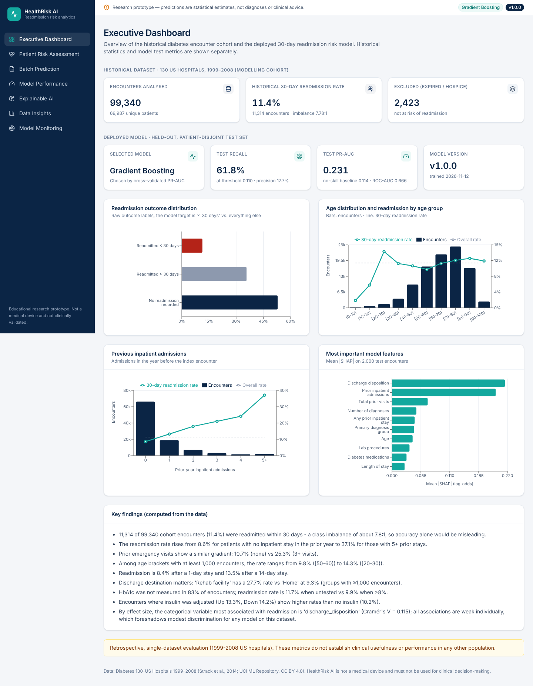
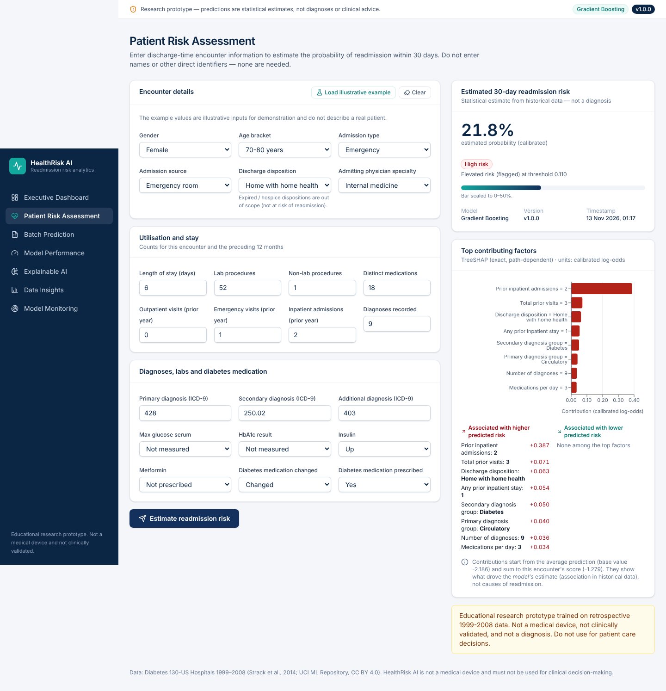
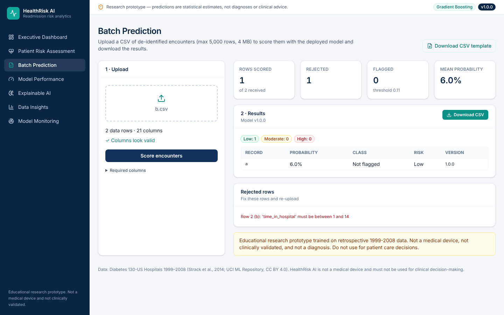
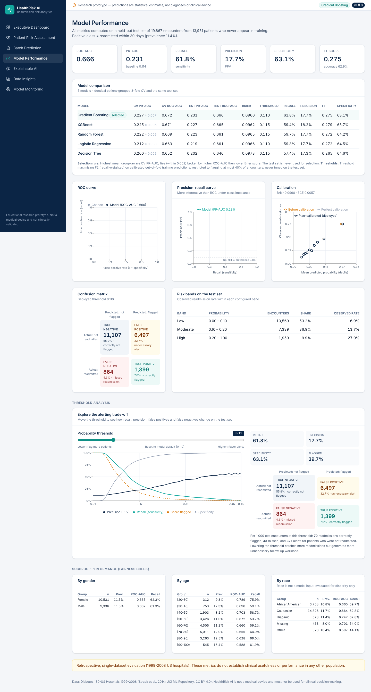
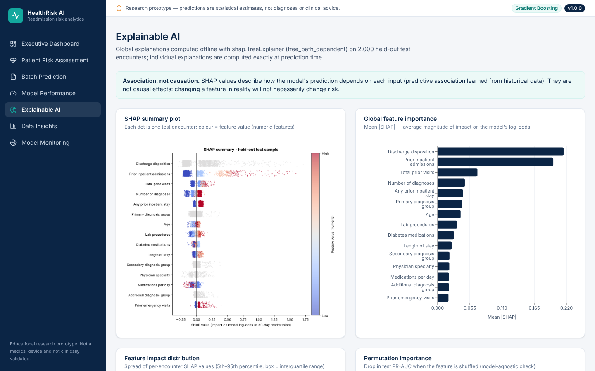
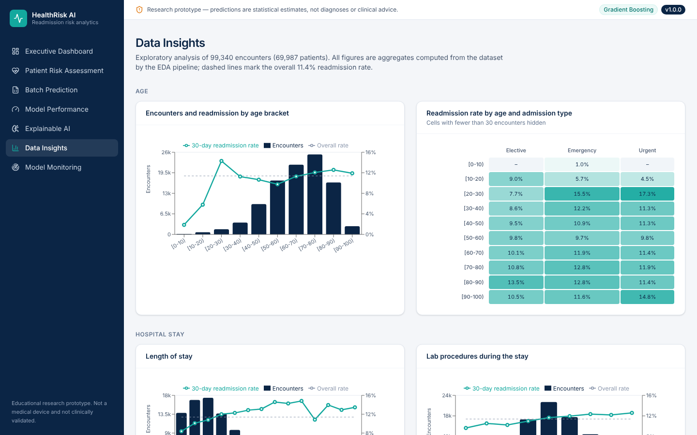
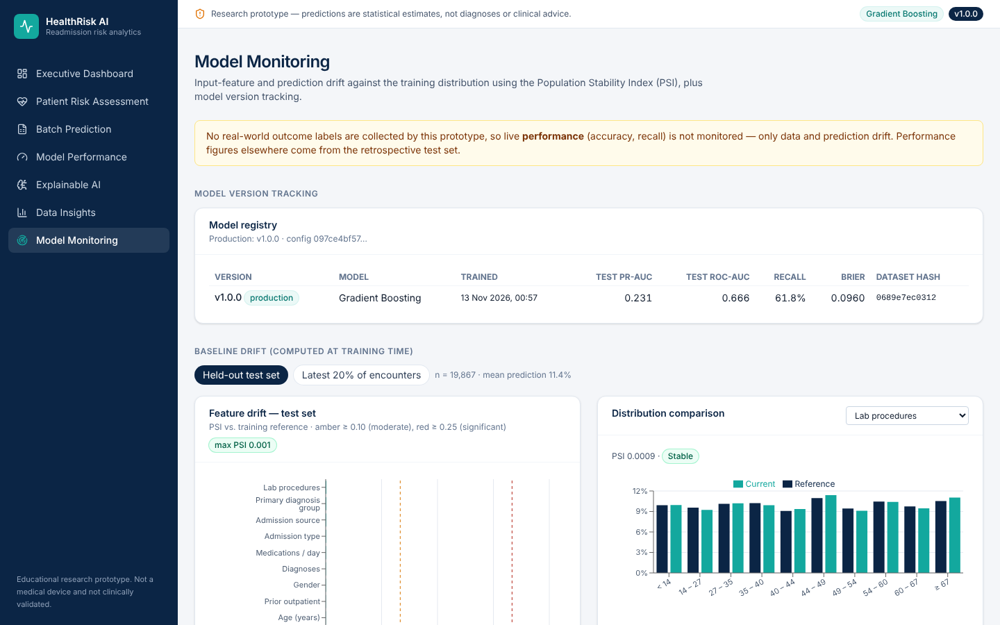
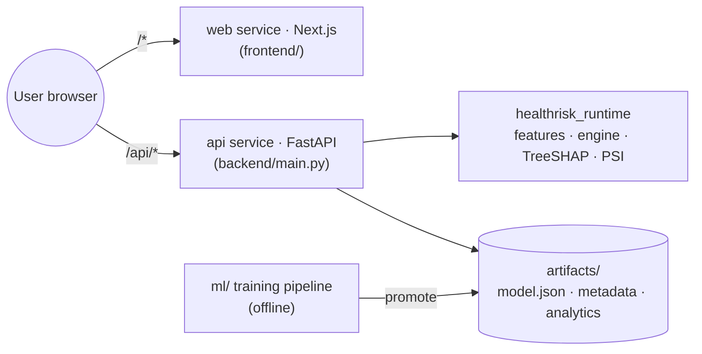

# HealthRisk AI: Intelligent Patient Readmission Risk Prediction Platform

An end-to-end, reproducible machine-learning system that estimates the probability that a patient with diabetes is
**readmitted to hospital within 30 days of discharge**. It explains each estimate and shows the results in an
enterprise-style analytics web app (Next.js + FastAPI) that is ready to deploy on Vercel.

> ⚠️ **Educational and research prototype.** It was trained on retrospective 1999–2008 US data. It is **not** a medical
> device, **not** clinically validated and **not** a diagnostic tool. Do not use it for patient care decisions.



---

## 1. Project overview

| | |
|---|---|
| Data | Diabetes 130-US Hospitals 1999–2008: 101,766 encounters, 71,518 patients, 50 columns |
| Task | Binary classification: readmitted `<30` days vs. not, predicted at **discharge** |
| Validation | Patient-grouped train/test split + patient-grouped 3-fold CV (no patient appears in both) |
| Models | Logistic Regression, Decision Tree, Random Forest, Gradient Boosting, XGBoost |
| Selected | **Gradient Boosting**, with Platt calibration and a recall-oriented threshold (0.110) |
| Explainability | SHAP (global, offline) + exact TreeSHAP per prediction (online, pure Python) |
| Serving | FastAPI with only 2 dependencies; the model is portable JSON (200 KB) with proven parity to sklearn |
| Frontend | Next.js 16, TypeScript, Tailwind CSS 4, Recharts, Lucide: 7 pages |
| MLOps | Dataset hash, config hash, versioned registry, metadata JSON, feature schema, PSI drift monitoring |
| Tests | 45 pytest + 17 Vitest tests, all passing |

## 2. Healthcare problem

Readmissions soon after discharge are costly and often signal gaps in care transitions. If teams can identify
encounters at elevated risk, they can *consider* targeted follow-up such as calls, medication reconciliation or
early clinic visits. This project shows how such a risk estimate could be built responsibly: leakage-safe
validation, calibrated probabilities, an explicit precision/recall trade-off, explanations and drift monitoring.

## 3. Dataset

- **Source:** [Kaggle: brandao/diabetes](https://www.kaggle.com/datasets/brandao/diabetes), which mirrors
  [UCI ML Repository #296](https://archive.ics.uci.edu/dataset/296/diabetes+130-us+hospitals+for+years+1999-2008)
  (CC BY 4.0). It was originally described by Strack et al. (2014).
- **SHA-256** of `diabetic_data.csv` used for v1.0.0: `0689e7ec031237dc63031b938805c48377748761a3b26acab621567afa24df97`

### Dataset setup

The raw data is **not** included in this repository or in the deployment.

```bash
# Option 1 - automatic (needs Kaggle credentials in ~/.kaggle/kaggle.json or KAGGLE_USERNAME/KAGGLE_KEY)
pip install kagglehub && python -m ml.data_ingestion --download

# Option 2 - manual
#   Download the zip from Kaggle or UCI and unzip it so these files exist:
#   data/raw/diabetic_data.csv   data/raw/IDS_mapping.csv
python -m ml.data_ingestion     # validates columns + writes reports/data_quality_report.md
```

## 4. Dataset limitations

- The data is old (1999–2008), US-only and covers diabetic inpatients only. Coding practices have changed since
  (see the drift analysis in §17).
- There are no dates, labs beyond HbA1c and glucose, vitals, social determinants or post-discharge information.
- `weight` is 97% missing, `medical_specialty` 49% and `payer_code` 40%.
- Readmissions to *other* hospitals may be missed. The label reflects only what the source system recorded.
- 46% of encounters come from patients with repeat stays. This is handled with patient-grouped splits.

## 5. Target definition

`readmitted_30d = 1` if `readmitted == "<30"`, otherwise `0` (`">30"` or `"NO"`). The positive rate in the cohort
is **11.39%**.

Encounters ending in death or hospice (2,423) are **removed** from the cohort, not labelled "not readmitted". The
full rationale and the leakage analysis are in [`docs/methodology.md`](docs/methodology.md).

## 6. Data preprocessing

All preprocessing is a scikit-learn `ColumnTransformer` inside a `Pipeline`, fitted on training folds only:

- **Numeric:** median imputation, then `StandardScaler`.
- **Categorical:** `"Missing"` imputation, then `OneHotEncoder(min_frequency=100, handle_unknown="infrequent_if_exist")`.
  Rare categories are pooled, and unseen categories are handled safely at inference.

**Excluded from model inputs, with reasons:**

| Column | Reason |
|---|---|
| target columns | Direct leakage |
| `encounter_id`, `patient_nbr` | Identifiers (`patient_nbr` is the grouping key only) |
| `weight` | 97% missing |
| `payer_code` | Missing and a socioeconomic proxy |
| `race` | Fairness. It is kept out of the model and used only for the subgroup audit. |
| `examide`, `citoglipton` | Constant columns |

## 7. Feature engineering

Stateless, discharge-time features are defined once in `backend/healthrisk_runtime/features.py` and shared by
training and inference:

- `total_prior_visits` and `any_prior_inpatient`
- `meds_per_day` (medication burden)
- `n_diabetes_meds` and `n_med_dose_changes`
- `insulin_treated` and `on_diabetes_med`
- `a1c_tested` and `glucose_tested`
- `age_years`
- ICD-9 chapter groups for three diagnoses
- `los_category`
- readable admission and discharge labels

Each feature is explained in [`docs/methodology.md`](docs/methodology.md#4-feature-engineering-backendhealthrisk_runtimefeaturespy).

## 8. ML pipeline architecture

```mermaid
flowchart LR
  A[diabetic_data.csv] --> B[Ingestion + validation<br/>quality report]
  B --> C[Cohort + binary target]
  C --> D[Stateless feature engineering]
  D --> E["Patient-grouped split<br/>80% train / 20% test"]
  E --> F["RandomizedSearchCV × 5 models<br/>StratifiedGroupKFold, 3 folds · PR-AUC"]
  F --> G["OOF Platt calibration<br/>+ F2 threshold, ≤40% alerts"]
  G --> H[Select by CV PR-AUC]
  H --> I[Test evaluation · SHAP · PSI reference]
  I --> J["Export portable JSON<br/>parity check below 1e-5"]
  J --> K[(models/registry.json<br/>backend/artifacts)]
  K --> L[FastAPI on Vercel]
  L --> M[Next.js dashboard on Vercel]
```



## 9. Model comparison (actual results)

These results come from the held-out test set: **19,867 encounters from 13,951 patients** who never appear in
training. Thresholds were chosen on out-of-fold training predictions.

| Model | CV PR-AUC (mean ± sd) | Test PR-AUC | Test ROC-AUC | Brier | Recall | Precision | F1 |
|---|---|---|---|---|---|---|---|
| **Gradient Boosting ✅** | **0.2265 ± 0.0071** | **0.2310** | **0.6662** | 0.0960 | 0.618 | 0.177 | 0.275 |
| XGBoost | 0.2251 ± 0.0058 | 0.2268 | 0.6651 | 0.0962 | 0.594 | 0.182 | 0.279 |
| Random Forest | 0.2220 ± 0.0060 | 0.2225 | 0.6607 | 0.0965 | 0.597 | 0.177 | 0.272 |
| Logistic Regression | 0.2119 ± 0.0083 | 0.2192 | 0.6610 | 0.0966 | 0.593 | 0.177 | 0.272 |
| Decision Tree | 0.1999 ± 0.0047 | 0.2018 | 0.6462 | 0.0973 | 0.574 | 0.173 | 0.265 |

The selection rule is the highest CV PR-AUC, with ties within 0.002 broken by ROC-AUC and then Brier score. The test
set is never used for selection. The top three models are within one CV standard deviation of each other.

## 10. Evaluation of the selected model

| Metric (test) | Value |
|---|---|
| ROC-AUC | 0.666 |
| PR-AUC | 0.231 (no-skill baseline 0.114) |
| Recall (sensitivity) @ 0.110 | 0.618 |
| Precision (PPV) | 0.177 |
| Specificity | 0.631 |
| F1 / Accuracy | 0.275 / 0.630 |
| Brier score / ECE | 0.0960 / 0.0057 (well calibrated) |
| Confusion matrix | TP 1,399 · FP 6,497 · FN 864 · TN 11,107 (39.7% flagged) |

The observed readmission rate in each risk band on the test set:

- **Low** (< 0.10): 6.9%
- **Moderate** (0.10–0.20): 13.7%
- **High** (≥ 0.20): 27.0%

**Interpretation:** discrimination is modest, which is typical for this dataset. Roughly 4–5 alerts are raised per
true readmission at the default threshold. The *Model Performance* page lets you move the threshold and see the
trade-off between catching more readmissions and creating unnecessary follow-up workload. Retrospective metrics do
**not** demonstrate clinical usefulness. The full report is in
[`reports/evaluation/evaluation_report.md`](reports/evaluation/evaluation_report.md).

## 11. Explainable AI

**Global explanations:** `shap.TreeExplainer` on 2,000 test encounters, plus permutation importance.

- The top drivers are discharge disposition, prior inpatient admissions, total prior visits, number of diagnoses and
  primary diagnosis group.

**Per prediction:** exact TreeSHAP is computed in pure Python at request time and verified against `shap` to 1e-5.

- Contributions are reported in calibrated log-odds and sum exactly to the prediction.
- The UI lists the factors associated with higher and with lower predicted risk.

These are **associations the model learned, not causes**.

## 12. Application screenshots

All screenshots were captured from the running application: the production Next.js build plus the FastAPI service,
run locally.

| | |
|---|---|
|  |  |
| Patient risk assessment with factors | Batch prediction and CSV export |
|  |  |
| Model comparison, curves and threshold explorer | SHAP summary and importance |
|  |  |
| Data insights | Drift monitoring and model registry |

## 13. System architecture



More detail is in [`docs/architecture.md`](docs/architecture.md).

## 14. Installation

Requirements: Python 3.12+ and Node.js 20+ (22 recommended).

```bash
git clone <your-repo> HealthRisk-AI && cd HealthRisk-AI
python -m venv .venv && source .venv/bin/activate      # Windows: .venv\Scripts\activate
pip install -r requirements-dev.txt                    # training + API + tests
cd frontend && npm ci && cd ..
```

## 15. Local execution

```bash
python -m ml.data_ingestion      # Phase 1 - validate data, quality report
python -m ml.eda                 # Phase 2 - EDA stats + figures
python -m ml.train               # Phases 3-6, 9 - train, evaluate, explain, export, register (~9 min on 2 CPUs)
python -m ml.train --quick       # 1-minute smoke run on a 15% patient subsample (not registered)

cd backend && uvicorn main:app --reload --port 8000    # API → http://localhost:8000/api/docs
cd frontend && npm run dev                              # UI  → http://localhost:3000

pytest                           # 45 Python tests (data, ML, export parity, SHAP, API)
cd frontend && npm test          # 17 Vitest tests (dashboard, form, prediction, CSV upload/export)
jupyter nbconvert --to notebook --execute notebooks/exploratory_analysis.ipynb --inplace
```

A trained model (v1.0.0) is already committed in `backend/artifacts/`, so the app runs without retraining.

**Reproducibility:**

- Seeds are fixed at 42.
- The dataset hash and config hash are stored in `models/<version>/metadata.json`, together with the library
  versions that were used.
- `requirements-ml.txt` pins those versions.

## 16. Vercel deployment

`vercel.json` deploys **one project with two services**: Next.js at `/` and FastAPI at `/api`. A local
`vercel build` with this configuration succeeded.

```bash
npm i -g vercel && vercel login
vercel          # preview
vercel --prod   # production
```

You can also import the GitHub repository in the Vercel dashboard and keep the root directory as is. A fallback with
two separate projects and the production smoke-test checklist are in [`docs/deployment.md`](docs/deployment.md).

**Live URL:** *not yet deployed.* Deployment needs the owner's Vercel account. Add the URL here once the
smoke-test checklist passes.

## 17. Limitations

- Modest discrimination (ROC-AUC ≈ 0.67). Precision of about 18% at the default threshold means many false alerts.
- The model has not been validated externally, prospectively or temporally. It is not suitable for clinical use.
- PSI comparing the latest 20% of encounters (by `encounter_id`) with training shows moderate drift:
  - discharge disposition 0.21
  - number of diagnoses 0.16
  - admission source 0.15

  This indicates that coding changed over time, so performance on new data may degrade.
- Subgroup metrics vary for small groups. Race is excluded from inputs, but proxies may remain.
- Monitoring covers inputs and predictions only. No outcome labels are collected, so live performance is not measured.
- The prediction-volume history is stored per browser, because the serverless deployment keeps no server-side state.

## 18. Future improvements

- **Validation:** temporal and external validation on recent data, and decision-curve and net-benefit analysis
  with clinicians.
- **Data:** richer features such as labs, vitals, social determinants and medication adherence, and sequence
  features from encounter history.
- **Monitoring:** outcome-label feedback for live performance monitoring, and a persistent prediction log in a
  HIPAA-appropriate store.
- **Modelling:** fairness constraints and per-group calibration checks, and conformal prediction intervals.
- **Infrastructure:** a model registry such as MLflow, CI-triggered retraining and canary releases.

---

### Project structure

```
HealthRisk-AI/
├── vercel.json                 # Vercel Services: web (frontend/) + api (backend/)
├── frontend/                   # Next.js 16 + TS + Tailwind + Recharts (7 pages, Vitest tests)
├── backend/
│   ├── main.py · schemas.py    # FastAPI + Pydantic
│   ├── api/index.py            # alternative entrypoint (standalone backend project)
│   ├── healthrisk_runtime/     # shared pure-Python: features, validation, engine/TreeSHAP, PSI
│   ├── artifacts/              # promoted model + metadata + analytics (deployed)
│   └── requirements.txt        # fastapi, pydantic only
├── ml/                         # ingestion, validation, eda, preprocessing, feature_engineering,
│                               # train, evaluate, explainability, export, monitoring, inference
├── notebooks/exploratory_analysis.ipynb   # executed, outputs included
├── models/                     # versioned models + registry.json + metadata/
├── reports/                    # data-quality, EDA, evaluation reports and figures
├── tests/                      # pytest suites
└── docs/                       # architecture, methodology, deployment, screenshots
```

*Citation:* Strack B. et al. (2014). Impact of HbA1c Measurement on Hospital Readmission Rates: Analysis of 70,000
Clinical Database Patient Records. *BioMed Research International*.
