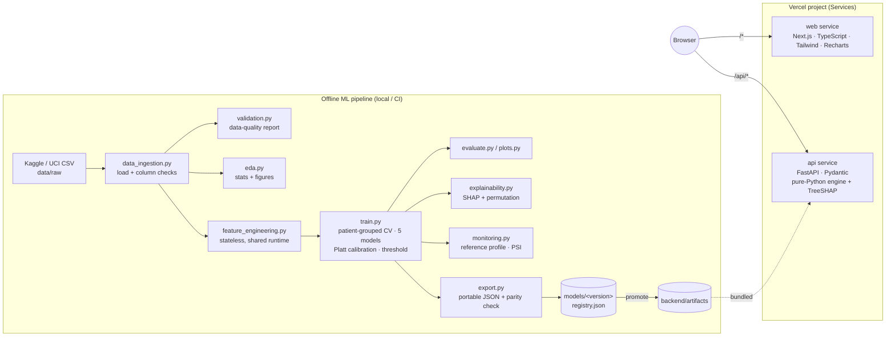

# Architecture

## Components

| Layer | Path | Responsibility |
|---|---|---|
| Shared runtime | `backend/healthrisk_runtime/` | Feature contract, feature engineering, validation, portable inference engine, TreeSHAP and PSI. Pure Python with no third-party dependencies, used by both training and serving. |
| Training | `ml/` | Ingestion, quality checks, EDA, preprocessing, model search, evaluation, SHAP, monitoring reference, export and registry. Heavy dependencies (pandas, scikit-learn, xgboost, shap) live only here. |
| API | `backend/main.py`, `backend/schemas.py` | FastAPI endpoints with Pydantic validation. Loads `artifacts/model.json` once at cold start. |
| Frontend | `frontend/` | Next.js App Router with 7 pages. All model output comes from the API. |
| Artefacts | `models/`, `backend/artifacts/`, `reports/` | Versioned models, metadata, evaluation and figures. |

## Why a portable JSON model instead of a pickle?

- The serverless bundle stays tiny: about 300 KB of artefacts plus `fastapi` and `pydantic`. There is no numpy,
  scikit-learn or xgboost, so cold starts are fast and the bundle is far below the 500 MB Python limit.
- Pickles are tied to library versions and can execute arbitrary code when loaded. The JSON model is plain data.
- **Parity is enforced.** `ml/train.py` aborts export if the engine and the sklearn pipeline differ by more than 1e-5
  on 500 test rows (observed: 4.4e-16). `tests/test_ml.py` checks export parity and exact SHAP agreement for all
  five model families.
- The full sklearn pipeline is still saved as `models/<version>/pipeline.joblib` for offline analysis.

## API endpoints

| Method | Path | Purpose |
|---|---|---|
| GET | `/api/health` | Liveness and whether the model is loaded |
| GET | `/api/model-info` | Name, version, training date, features, metrics, registry, environment |
| GET | `/api/schema` | Input contract and feature descriptions |
| POST | `/api/predict?explain=true` | One encounter → probability, class, risk band, version, timestamp, SHAP factors |
| POST | `/api/batch-predict?format=json\|csv` | CSV body (≤ 5,000 rows, ≤ 4 MB) → per-row predictions and rejected rows |
| POST | `/api/monitoring/drift` | CSV body → PSI per feature and prediction histogram vs. training |
| GET | `/api/analytics[?section=]` | Pre-computed aggregate EDA, evaluation, XAI and drift (no row-level data) |
| GET | `/api/docs` | Swagger UI |

## Security and privacy

- **No direct identifiers are accepted.** `extra="forbid"` rejects unknown fields on `/predict`, and CSV uploads
  containing columns such as `name`, `phone` or `address` are refused.
- **Logs** contain only method, path, status and latency. Request bodies are never logged.
- **Nothing is persisted server-side.** The prediction-volume chart is stored in the viewer's browser only.
- **Input bounds**: strict ranges, enum values and an ICD-9 regex. Batch size is capped below Vercel's 4.5 MB body limit.
- **Exported CSVs** are guarded against spreadsheet formula injection.
- **Headers**: `nosniff`, `X-Frame-Options: DENY`, `Referrer-Policy`, and `Cache-Control: no-store` on API responses.
- No secrets are required. `.env.example` lists optional variables only.

## MLOps lifecycle

1. `python -m ml.data_ingestion` validates the CSV, computes its SHA-256 and writes `reports/data_quality_report.*`.
2. `python -m ml.eda` writes `reports/eda_summary.json` and the figures.
3. `python -m ml.train` writes the versioned directory `models/<version>/`:
   - `model.json`, `pipeline.joblib`, `metadata.json` (dataset hash, config hash, parameters, metrics, environment), `evaluation.json` and `feature_schema.json`
   - an appended `models/registry.json`
   - promoted artefacts in `backend/artifacts/`
4. Commit and push. Vercel redeploys, and the API serves the new version (`/api/model-info` shows it).
5. Compare versions using `models/registry.json` or the **Model Monitoring → Model registry** table.
